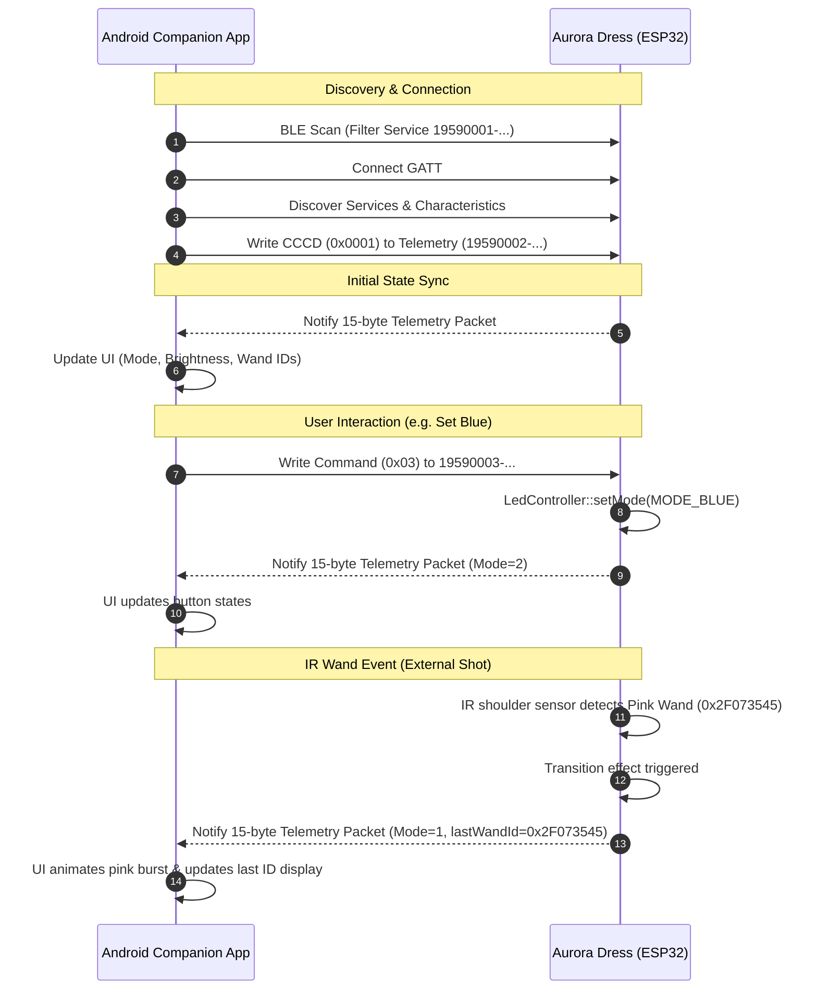

# Bluetooth Low Energy (BLE 5.0) GATT Specification & Companion App Architecture

## Overview

The Princess Aurora Interactive Dress firmware replaces legacy WiFi SoftAP and HTTP web server controls with a lightweight, high-performance, low-latency **Bluetooth Low Energy (BLE 5.0) GATT Server**.

This document specifies:
1. **The GATT Profile & Protocols** implemented on the ESP32 (XIAO ESP32-C3 / XIAO ESP32-S3).
2. **Binary Data Formats** for telemetry, commands, and brightness controls.
3. **Android Companion Application Requirements** for building a native Android client (Kotlin + Jetpack Compose) in a dedicated repository.

---

## 1. BLE GATT Server Specification

### 1.1 Device Identification
- **Advertised Device Name**: `Aurora-Dress`
- **Advertisement Flags**: `ESP_BLE_ADV_FLAG_GEN_DISC | ESP_BLE_ADV_FLAG_BREDR_NOT_SPT` (General Discoverable, BLE only / No BR/EDR)
- **Advertised Service UUID**: `19590001-d1e5-4e3b-9a14-c0104d4e5353`

### 1.2 GATT Service & Characteristic UUID Hierarchy

| Entity | UUID | Properties | Permissions | Description |
| :--- | :--- | :--- | :--- | :--- |
| **Dress Control Service** | `19590001-d1e5-4e3b-9a14-c0104d4e5353` | Primary | - | Root service for dress telemetry and commands |
| **Telemetry Characteristic** | `19590002-d1e5-4e3b-9a14-c0104d4e5353` | `READ`, `NOTIFY` | Read | 15-byte packed struct containing real-time state |
| **Client Characteristic Configuration (CCCD)** | `00002902-0000-1000-8000-00805f9b34fb` | `READ`, `WRITE` | Read, Write | Enables notifications (`0x0001`) |
| **Command Characteristic** | `19590003-d1e5-4e3b-9a14-c0104d4e5353` | `WRITE`, `WRITE_NO_RESPONSE` | Write | 1-byte opcode for mode switches & wand pairing |
| **Brightness Characteristic** | `19590004-d1e5-4e3b-9a14-c0104d4e5353` | `READ`, `WRITE`, `WRITE_NO_RESPONSE` | Read, Write | 1-byte unsigned integer (`0`–`255`) |

---

## 2. Binary Protocol & Data Layout

### 2.1 Telemetry Packet (`DressTelemetryPacket`)
The Telemetry Characteristic (`19590002-...`) provides a **15-byte fixed-size binary payload** packed with 1-byte alignment (`#pragma pack(push, 1)`):

```c
struct __attribute__((packed)) DressTelemetryPacket {
    uint8_t  mode;          // Offset 0:  Current dress lighting mode (0-4)
    uint8_t  brightness;    // Offset 1:  Current global brightness (0-255)
    uint8_t  pairingState;  // Offset 2:  Wand pairing status (0-2)
    uint32_t pinkWandId;    // Offset 3:  Configured Pink Wand ID (Little-Endian uint32)
    uint32_t blueWandId;    // Offset 7:  Configured Blue Wand ID (Little-Endian uint32)
    uint32_t lastWandId;    // Offset 11: Last decoded IR wand raw ID (Little-Endian uint32)
}; // Total: 15 bytes
```

#### Field Details:
1. **`mode`** (`uint8_t`, 1 byte):
   - `0` (`0x00`): **OFF** (LEDs black, standby)
   - `1` (`0x01`): **PINK** (Flora's Pink breathing/solid effect)
   - `2` (`0x02`): **BLUE** (Merryweather's Blue breathing/solid effect)
   - `3` (`0x03`): **SPLOTCHES** (Dynamic interactive battle: Pink vs Blue fairy splotches)
   - `4` (`0x04`): **PAIRING_FEEDBACK** (Visual confirmation blink on wand registration)
2. **`brightness`** (`uint8_t`, 1 byte):
   - Value `0` (off) to `255` (full 100% duty cycle).
3. **`pairingState`** (`uint8_t`, 1 byte):
   - `0` (`0x00`): **NONE** (Normal runtime mode)
   - `1` (`0x01`): **PAIR_PINK** (Listening for next IR wand signal to assign to Pink)
   - `2` (`0x02`): **PAIR_BLUE** (Listening for next IR wand signal to assign to Blue)
4. **`pinkWandId`** (`uint32_t`, 4 bytes, Little-Endian):
   - Stored 32-bit hardware ID for Flora's wand.
5. **`blueWandId`** (`uint32_t`, 4 bytes, Little-Endian):
   - Stored 32-bit hardware ID for Merryweather's wand.
6. **`lastWandId`** (`uint32_t`, 4 bytes, Little-Endian):
   - Most recently received 32-bit IR code from either shoulder sensor (`0` if none).

---

### 2.2 Command Protocol (`19590003-...`)
Clients send a **single-byte command opcode** via `WRITE` or `WRITE WITHOUT RESPONSE`:

| Opcode (Hex) | Opcode (Dec) | Action | Behavior |
| :--- | :--- | :--- | :--- |
| `0x01` | 1 | **Turn Off** | Sets mode to `OFF`; turns off LED output |
| `0x02` | 2 | **Set Pink Mode** | Transitions dress to Pink mode |
| `0x03` | 3 | **Set Blue Mode** | Transitions dress to Blue mode |
| `0x04` | 4 | **Set Splotches Mode** | Starts dynamic Pink/Blue fairy spell battle |
| `0x10` | 16 | **Start Pair Pink** | Enters `PAIR_PINK` state; next wand shot registers as Pink wand |
| `0x11` | 17 | **Start Pair Blue** | Enters `PAIR_BLUE` state; next wand shot registers as Blue wand |
| `0x12` | 18 | **Cancel Pairing** | Cancels active pairing mode and returns to normal operation |

*Unknown opcodes are logged to Serial and ignored.*

---

### 2.3 Brightness Control (`19590004-...`)
- **Payload**: 1 byte (`uint8_t`), range `0` to `255`.
- **Write Type**: `WRITE_NO_RESPONSE` is recommended for smooth continuous slider drags to prevent GATT congestion.

---

### 2.4 Notification & State Flow



---

## 3. Android Companion App Requirements

The Android application will be built in a separate repository. Below are the functional, architectural, and security specifications for that application.

### 3.1 Platform Requirements
- **Language**: Kotlin
- **Minimum SDK**: Android 8.0 (API level 26 - `Oreo`)
- **Target / Compile SDK**: Android 14 (API level 34)
- **UI Framework**: Jetpack Compose with Material 3
- **BLE Library Options**: 
  - Standard Android `BluetoothGatt` API, or
  - Nordic Semiconductor Android-BLE-Library (strongly recommended for robust connection queuing and lifecycle management).

---

### 3.2 Android Permissions Architecture

#### Android 12+ (API 31+) Permissions:
```xml
<!-- In AndroidManifest.xml -->
<uses-permission android:name="android.permission.BLUETOOTH_SCAN"
    android:usesPermissionFlags="neverForLocation" />
<uses-permission android:name="android.permission.BLUETOOTH_CONNECT" />
```

#### Android 11 and below (API <= 30) Fallback Permissions:
```xml
<uses-permission android:name="android.permission.BLUETOOTH" android:maxSdkVersion="30" />
<uses-permission android:name="android.permission.BLUETOOTH_ADMIN" android:maxSdkVersion="30" />
<uses-permission android:name="android.permission.ACCESS_FINE_LOCATION" android:maxSdkVersion="30" />
```

#### Hardware Feature Declarations:
```xml
<uses-feature android:name="android.hardware.bluetooth_le" android:required="true" />
```

---

### 3.3 Application Architecture & UI Screens

The app should follow modern Android Architecture (`MVI` or `MVVM` with `StateFlow` and unidirectional data flow):

```
┌────────────────────────────────────────────────────────┐
│                      Jetpack Compose UI                │
│  - Connection Bar (RSSI, Status, Disconnect)           │
│  - Mode Selector (Off, Pink, Blue, Splotches)          │
│  - Brightness Slider (Debounced write)                 │
│  - Wand Configuration & Pairing Card                   │
│  - Live Telemetry & IR Debug Inspector                 │
└───────────────────────────▲────────────────────────────┘
                            │ StateFlow<DressUiState>
┌───────────────────────────┴────────────────────────────┐
│                    DressViewModel                      │
│  - Processes user intents (click pink, change bright) │
│  - Unpacks 15-byte telemetry buffer into Domain model  │
│  - Auto-reconnect & connection lifecycle handler       │
└───────────────────────────▲────────────────────────────┘
                            │
┌───────────────────────────┴────────────────────────────┐
│                  BleDressRepository                    │
│  - BLE Scanner (Service Filter: 19590001-...)          │
│  - GATT Client & CCCD Subscription                     │
│  - Characteristic Read / Write / Notify dispatcher     │
└────────────────────────────────────────────────────────┘
```

#### Core UI Features:
1. **Scanning & Auto-Connect**:
   - Filter scans by Service UUID `19590001-d1e5-4e3b-9a14-c0104d4e5353` or device name `"Aurora-Dress"`.
   - Remember the MAC address of the last connected dress and auto-reconnect on app launch.
2. **Mode Controls**:
   - Themed toggle buttons:
     - 🌸 **Make it Pink!** (`#FF69B4` / `#FF1493`)
     - 💙 **Make it Blue!** (`#1E90FF` / `#00BFFF`)
     - ✨ **Splotches Battle** (Dynamic animated gradient)
     - 🛑 **Turn Off**
   - Active mode highlighted according to the received telemetry state.
3. **Brightness Control**:
   - Slider from 0 to 100% (mapping to 0–255).
   - Throttle/debounce writes to ~30–50ms to prevent BLE buffer congestion.
4. **Wand Pairing & Diagnostic Card**:
   - Displays configured **Pink Wand ID** (hex format: e.g. `0x2F073545`).
   - Displays configured **Blue Wand ID** (hex format).
   - "Pair Pink Wand" and "Pair Blue Wand" action buttons:
     - When clicked, shows a pulsing countdown / listening dialog.
     - When pairing completes or times out, returns to idle.
   - **Live IR Debug Log**:
     - Shows the `lastWandId` in real-time as physical wands are fired at the dress shoulders.

---

### 3.4 Telemetry Byte Unpacking (Kotlin Sample)

```kotlin
data class DressTelemetry(
    val mode: DressMode,
    val brightness: Int,
    val pairingState: PairingState,
    val pinkWandId: Long,
    val blueWandId: Long,
    val lastWandId: Long
)

enum class DressMode(val value: Int) {
    OFF(0), PINK(1), BLUE(2), SPLOTCHES(3), PAIRING_FEEDBACK(4);
    companion object {
        fun fromInt(v: Int) = entries.find { it.value == v } ?: OFF
    }
}

enum class PairingState(val value: Int) {
    NONE(0), PAIR_PINK(1), PAIR_BLUE(2);
    companion object {
        fun fromInt(v: Int) = entries.find { it.value == v } ?: NONE
    }
}

fun parseTelemetry(bytes: ByteArray): DressTelemetry? {
    if (bytes.size != 15) return null
    val buffer = java.nio.ByteBuffer.wrap(bytes).order(java.nio.ByteOrder.LITTLE_ENDIAN)
    val mode = buffer.get().toInt() and 0xFF
    val brightness = buffer.get().toInt() and 0xFF
    val pairingState = buffer.get().toInt() and 0xFF
    val pinkWandId = buffer.getInt().toLong() and 0xFFFFFFFFL
    val blueWandId = buffer.getInt().toLong() and 0xFFFFFFFFL
    val lastWandId = buffer.getInt().toLong() and 0xFFFFFFFFL

    return DressTelemetry(
        mode = DressMode.fromInt(mode),
        brightness = brightness,
        pairingState = PairingState.fromInt(pairingState),
        pinkWandId = pinkWandId,
        blueWandId = blueWandId,
        lastWandId = lastWandId
    )
}
```
